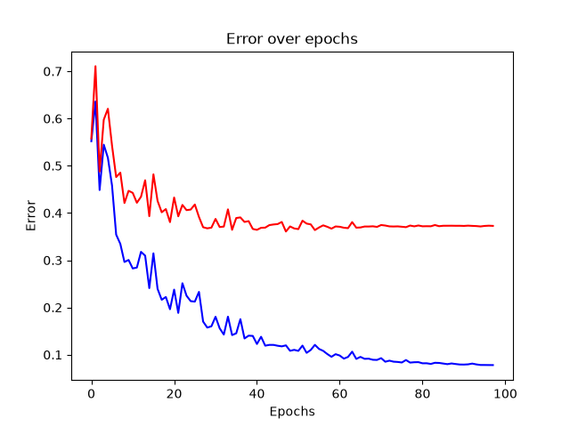
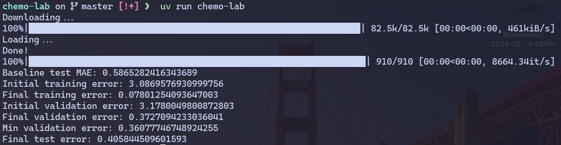

# Chemo Lab

> **Note:** This is a **learning project**. It was built as a hands-on exercise to understand
> machine learning fundamentals in computational chemistry/ADME prediction. Expect rough
> edges, hardcoded values, and experiments-in-progress.

## What it does

`chemo-lab` predicts **Caco-2 cell permeability** (how easily a compound crosses intestinal
cell walls) directly from a molecule's SMILES string.

## How it works

1. **Data** — Loads the `Caco2_Wang` dataset from
   [PyTDC](https://tdcommons.ai/) (`single_pred/ADME`) and performs a
   **scaffold split** (train/valid/test) so that structurally related molecules
   stay in the same split.
2. **Features** — Each molecule is converted into a feature vector:
   - a 512-bit **Morgan count fingerprint** (radius 2, via RDKit)
   - engineered molecular descriptors: exact molecular weight, H-bond donors,
     H-bond acceptors, and topological polar surface area (TPSA) — each scaled.
3. **Model** — A small MLP written **from scratch with raw PyTorch tensors**
   (no `nn.Module`, no autograd config, no optimizers): manual forward pass,
   manual gradient step, MAE loss, weight decay, and a decaying learning rate.
4. **Evaluation** — Tracks training and validation MAE per epoch, keeps the
   best-validated weights, and finally reports test MAE against a
   **median baseline**. Matplotlib plots the error curves.

## Screenshot of the result

### Error over epochs



### Results



## Running it

Prerequisites: Python 3.11 and [uv](https://docs.astral.sh/uv/).

```bash
uv sync            # install dependencies
uv run chemo-lab   # train and evaluate
```

On macOS with Apple Silicon it will automatically use the MPS (Metal) backend;
otherwise it falls back to CPU.

## Tech stack

- [PyTorch](https://pytorch.org/) — tensors, autograd for the manual backward passes
- [RDKit](https://www.rdkit.org/) — cheminformatics (SMILES parsing, fingerprints, descriptors)
- [PyTDC](https://tdcommons.ai/) — dataset loading and splitting
- [matplotlib](https://matplotlib.org/) — error plots
- [catboost](https://catboost.ai/) / [lightgbm](https://lightgbm.readthedocs.io/) / [scikit-learn](https://scikit-learn.org/) — installed for future experiments

## What I want to explore next

- [ ] Compare against CatBoost/LightGBM on the same features
- [ ] Different fingerprint types and sizes
- [ ] Better hyperparameters / architectures
