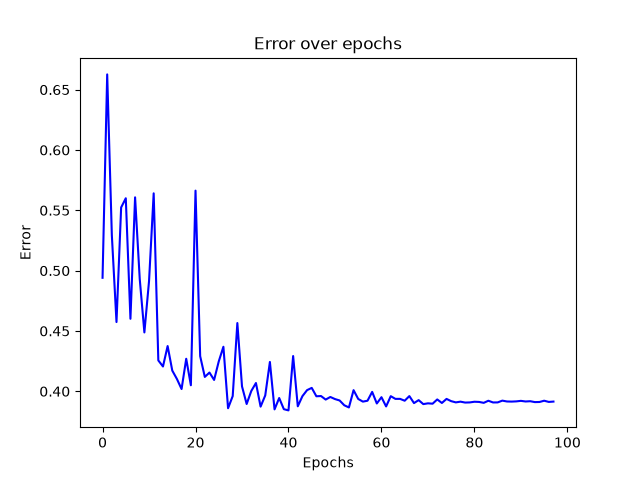
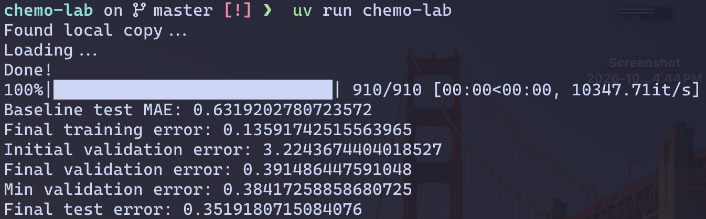

# Chemo Lab

> **Note:** This is a **learning project**. It was built as a hands-on exercise to understand
> machine learning fundamentals in computational chemistry/ADME prediction. Expect rough
> edges, hardcoded values, and experiments-in-progress.

## What it does

`chemo-lab` predicts **Caco-2 cell permeability** (how easily a compound crosses intestinal
cell walls) directly from a molecule's SMILES string.

## How it works

1. **Data** — Loads the `Caco2_Wang` dataset (910 molecules) from
   [PyTDC](https://tdcommons.ai/) (`single_pred/ADME`) and performs a
   **scaffold split** (train/valid/test) so that structurally related molecules
   stay in the same split.
2. **Features** — Each molecule is converted into a 516-dimensional feature
   vector:
   - a 512-bin **Morgan count fingerprint** (radius 2, chirality-aware, via
     RDKit)
   - engineered molecular descriptors, each scaled by hand: exact molecular
     weight / 500, H-bond donors / 5, H-bond acceptors / 10, and topological
     polar surface area / 200.
3. **Model** — A small MLP (`nn.Module`: 516 → 100 → 25 → 1 with ReLU) trained
   with mini-batches (`DataLoader`), MAE loss (`nn.L1Loss`), **SGD with weight
   decay**, and an exponentially decaying learning rate (`ExponentialLR`).
4. **Evaluation** — Tracks validation MAE per epoch, keeps the best-validated
   weights, and finally reports train/validation/test MAE against a
   **median baseline**. Matplotlib plots the validation error curve.

## Latest results

Baseline (predicting the median) test MAE: **0.632**

| metric               | MAE       |
| -------------------- | --------- |
| final training error | 0.136     |
| min validation error | 0.384     |
| final test error     | **0.352** |

### Error over epochs



### Results



## Running it

Prerequisites: Python 3.11 and [uv](https://docs.astral.sh/uv/).

```bash
uv sync            # install dependencies
uv run chemo-lab   # train and evaluate
```

On macOS with Apple Silicon it will automatically use the MPS (Metal) backend;
otherwise it falls back to CPU.

## Tech stack

- [PyTorch](https://pytorch.org/) — `nn.Module` MLP, autograd, optim, `DataLoader`
- [RDKit](https://www.rdkit.org/) — cheminformatics (SMILES parsing, fingerprints, descriptors)
- [PyTDC](https://tdcommons.ai/) — dataset loading and splitting
- [matplotlib](https://matplotlib.org/) — error plots
- [catboost](https://catboost.ai/) / [lightgbm](https://lightgbm.readthedocs.io/) / [scikit-learn](https://scikit-learn.org/) — installed for future experiments

## What I want to explore next

- [ ] Compare against CatBoost/LightGBM on the same features
- [ ] Understand regression trees by implementing one from scratch
- [ ] Different fingerprint types and sizes
